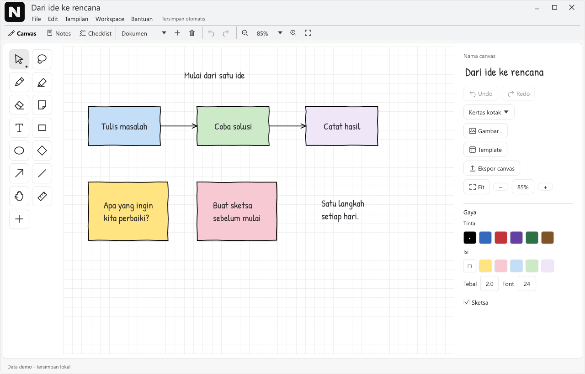
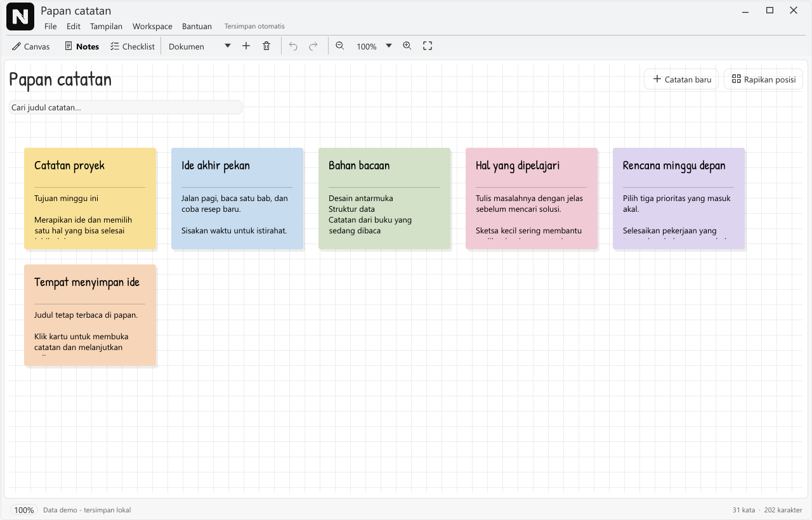
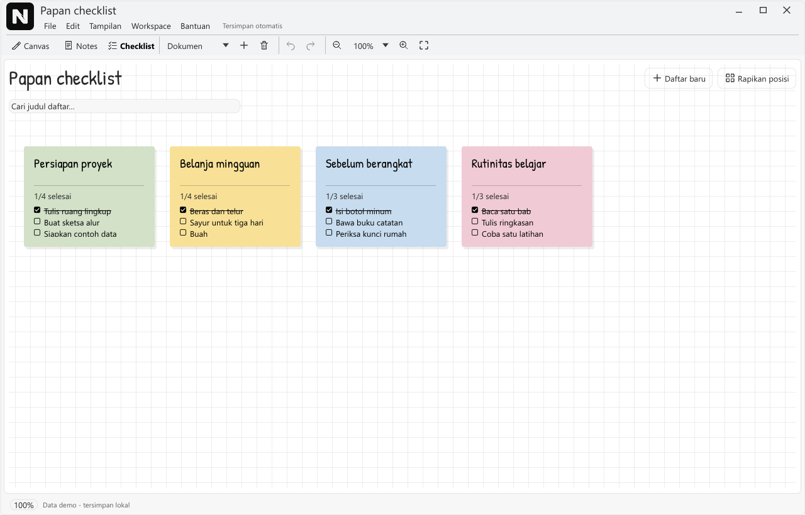

# Notvas

Notvas adalah aplikasi desktop Windows untuk menggambar ide, menulis catatan, dan mengelola checklist. Semua data disimpan dalam workspace lokal. Antarmukanya memakai kertas berkotak, tulisan tangan, dan kartu pastel.

Proyek masih dalam pengembangan. Source di repository berisi perubahan terbaru; paket EXE lama bisa memiliki fitur yang berbeda.

## Fitur utama

| Modul | Yang bisa dilakukan |
| --- | --- |
| Canvas | Menggambar dengan pena dan stabilo, membuat shape, menambahkan teks/gambar, serta menghubungkan objek dengan panah lurus, siku, atau lengkung. Sambungan mengikuti shape saat dipindahkan. |
| Notes | Menyusun catatan pada papan kartu berwarna, mencari judul, lalu membuka editor penuh. Mendukung format teks, gambar dalam alur tulisan atau overlay, dan ekspor HTML/TXT. |
| Checklist | Menyusun beberapa daftar pada papan kartu. Setiap kartu menampilkan progres dan cuplikan tugas. Buka daftar untuk mencentang, mengedit, atau menghapus tugas. |

Autosave berjalan setelah jeda mengetik dan saat berpindah dokumen atau menutup aplikasi. Versi sebelumnya disimpan sebagai backup. Ctrl+scroll mengatur zoom; drag kanan atau swipe menggeser area kerja. [Panduan penggunaan dan shortcut](docs/USAGE.md) menjelaskan kontrolnya.

## Tampilan

Canvas dengan shape terhubung, sticky notes, dan panel alat:



Papan Notes dan pencarian judul:



Papan Checklist dengan progres setiap daftar:



Lihat juga [editor Notes](docs/screenshots/note-editor.png) dan [daftar Checklist penuh](docs/screenshots/checklist-editor.png). Gambar dibuat dari frame UI Notvas dengan data demo melalui renderer CPU, bukan capture jendela Windows. [Metode dan cara membuat ulang](docs/screenshots/README.md).

## Menjalankan

Gunakan Windows, Rust stable, dan linker yang sesuai dengan toolchain Windows. Dependensi dipatok dalam `Cargo.lock`.

```powershell
.\run.ps1
```

Script memakai toolchain portable di `.tools` jika tersedia, atau Cargo dari PATH. `.tools` merupakan folder lokal dan tidak disertakan dalam repository. Untuk build release:

```powershell
.\run.ps1 -Release -BuildOnly
```

Hasilnya ada di `target/release/notvas.exe`. [Panduan distribusi](docs/RELEASING.md) menjelaskan cara membuat ZIP portable beserta lisensinya.

## Development

```powershell
.\dev.ps1 -Watch
```

Mode watch memantau source dan aset, meminta aplikasi menyelesaikan autosave, lalu build dan restart. Data development berada di `.dev-data`, terpisah dari data normal. Rust tetap memerlukan kompilasi; perubahan berikutnya memakai cache incremental.

Untuk menjalankan tes:

```powershell
.\run.ps1 -Test
```

CI menjalankan formatter, tes, dan build di Windows. [Panduan development](docs/DEVELOPMENT.md) mencatat struktur source, data demo, dan generator gambar. Hasil pemeriksaan lokal ada di [QA.md](QA.md).

## Penyimpanan

Lokasi awal workspace adalah `%APPDATA%\Notvas\workspace.notvas`. File `.notvas` berisi JSON, termasuk teks, tugas, objek, dan gambar tertanam. Versi sebelumnya disimpan sebagai `.notvas.bak`. File ini belum dienkripsi.

Untuk memakai folder lain:

```powershell
.\Notvas.exe --data-dir .\data-pribadi
```

Notvas tidak memiliki akun, telemetri, atau layanan unggah. Periksa [informasi data dan privasi](PRIVACY.md), terutama sebelum membagikan workspace atau ekspor.

## Batasan

Belum ada sinkronisasi, kolaborasi, enkripsi, impor PDF/PPT/Word, atau dukungan format `.excalidraw`. Smart snap memakai geometri lokal. Ekspor HTML/SVG/PNG bersifat satu arah, dan undo tidak disimpan ke disk. Aplikasi ditujukan untuk Windows; belum ada paket Android/iOS.

## Berkontribusi

Laporkan bug atau usulkan fitur di [Issues](https://github.com/yudnata/notvas/issues). Ikuti [CONTRIBUTING.md](CONTRIBUTING.md) untuk perubahan kode dan [SECURITY.md](SECURITY.md) untuk laporan keamanan. Gunakan data demo saat melampirkan contoh atau gambar.

## Lisensi

Kode dan aset proyek memakai [MIT](LICENSE). Font Patrick Hand tetap memakai [SIL Open Font License 1.1](assets/fonts/OFL-PatrickHand.txt); komponen lain mengikuti lisensi upstream. Lihat [NOTICE.md](NOTICE.md) dan [inventaris dependensi](THIRD_PARTY_NOTICES.md) untuk atribusi serta teks lisensinya.
